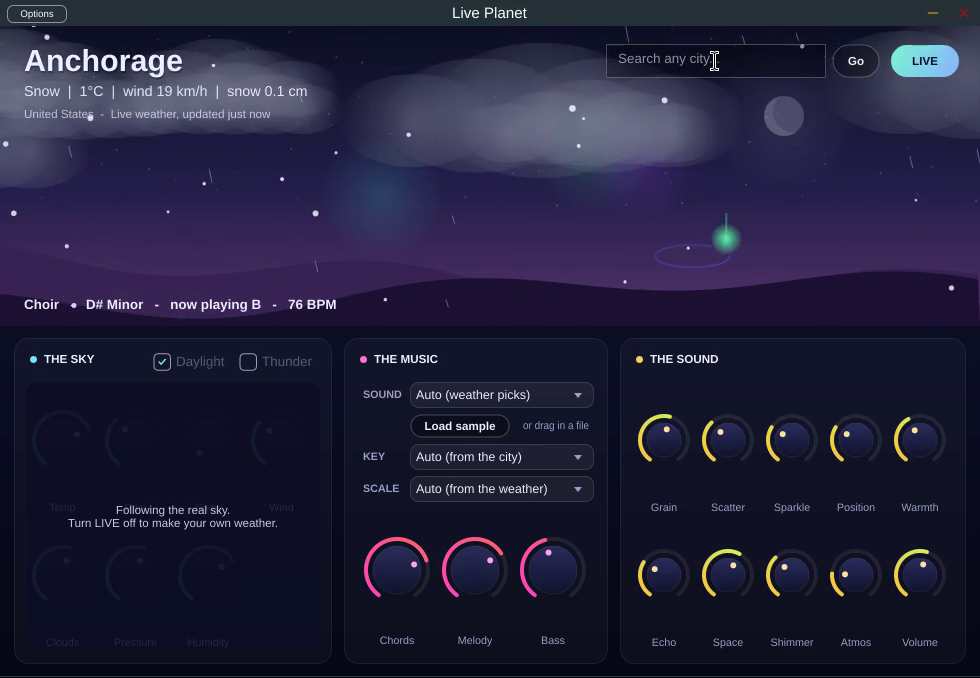

# Live Planet



An instrument plugin played by the weather. Pick any city on Earth and its live weather plays dreamy granular chords and melodies, always in key and in time with your song.

| Weather | What it does to the music |
|---|---|
| Temperature + sunshine | Mood: warm and sunny is bright (Lydian, Major); cold and grey is moody (Dorian, Minor) |
| Rain | Melody: every raindrop is a note, so drizzle gives a few notes and a storm gives flurries |
| Clouds | Chord size: clear sky plays simple triads, overcast plays big 9th and 11th chords |
| Air pressure | Chord progression: high pressure is calm and resolved, low pressure is tense |
| Wind | Tempo, strum speed, rolling arpeggios and how much the sound swirls |
| Snow | Slow, hazy, frozen; chords turn into soft sus2 voicings |
| Lightning | A thunder boom and a bright chord hit |
| Humidity / fog | More reverb haze |
| The city's name | The key (every city has its own key; you can override it) |

Hold keys on a MIDI keyboard and your notes become the chord while the weather keeps playing it. The notes also go out as MIDI, so Live Planet can play any other instrument.

**Sounds:** seven instruments, each played its own way with its own effects:

| Sound | How it plays | Auto mode picks it for |
|---|---|---|
| Glass | shimmering grain clouds and bells | light rain |
| Choir | slow "aah" voices, huge reverb | snowy nights, fog |
| Felt Piano | struck soft piano chords and melody | heavy rain, grey days |
| Music Box | rolled tine arpeggios, lo-fi wobble | calm nights, snowy days |
| Nylon Guitar | strummed plucked strings | mild sunny days |
| Tape Strings | warm, wobbly string section | storms and strong wind |
| Vapor Synth | wide glossy supersaw, big echoes | hot sunny days |

Choose **Auto** and the weather picks the instrument (it re-chooses every 8 bars and whenever you change city), or drag in any audio file of your own.
**Effects:** grain size, scatter, sparkle (octave-up glitter), tape warmth and wobble, ping-pong echo, reverb with shimmer, and real rain and wind noise.

Formats: VST3, AU (Mac), CLAP and a standalone app, for macOS, Windows and Linux.

## Building

```bash
git clone --recurse-submodules <this repo>
cmake -S . -B build -DCMAKE_BUILD_TYPE=Release
cmake --build build --config Release
```

The plugins appear in `build/LivePlanet_artefacts/Release/`. Every push to GitHub also builds Mac, Windows and Linux versions automatically (see the Actions tab).

`RenderDemo` renders example skies to WAV files without a DAW:

```bash
./build/RenderDemo_artefacts/Release/RenderDemo renders 45
```

## Code map

- `Source/engine/Weather.h`: the sky and the 0..1 values the music uses
- `Source/engine/Theory.h`: scales, chord progressions, repeatable randomness
- `Source/engine/Engine.cpp`: weather → harmony, the 16th-note clock, grain engine and effects
- `Source/engine/Sources.h`: the built-in sounds, generated from pure math (no recorded samples)
- `Source/engine/Profiles.h`: how each sound is played, its effects, and which weather picks it
- `Source/plugin/`: the plugin wrapper, live weather fetching and the animated sky screen

## Before selling it

- **Sounds:** every built-in sound is generated by code in this project, with no third-party samples, so you own them outright.
- **JUCE** (the plugin framework) is dual licensed: AGPLv3, or a commercial licence for closed-source products. Check the current JUCE licence tiers at juce.com before you sell.
- **Weather data** comes from Open-Meteo. Its free API is for non-commercial use only, so a paid product needs one of their commercial plans or a different weather provider.
- **Mac builds** need to be signed and notarized with an Apple Developer account so they install without warnings.
- **Pro Tools (AAX)** needs a free developer agreement with Avid plus their signing tools.
